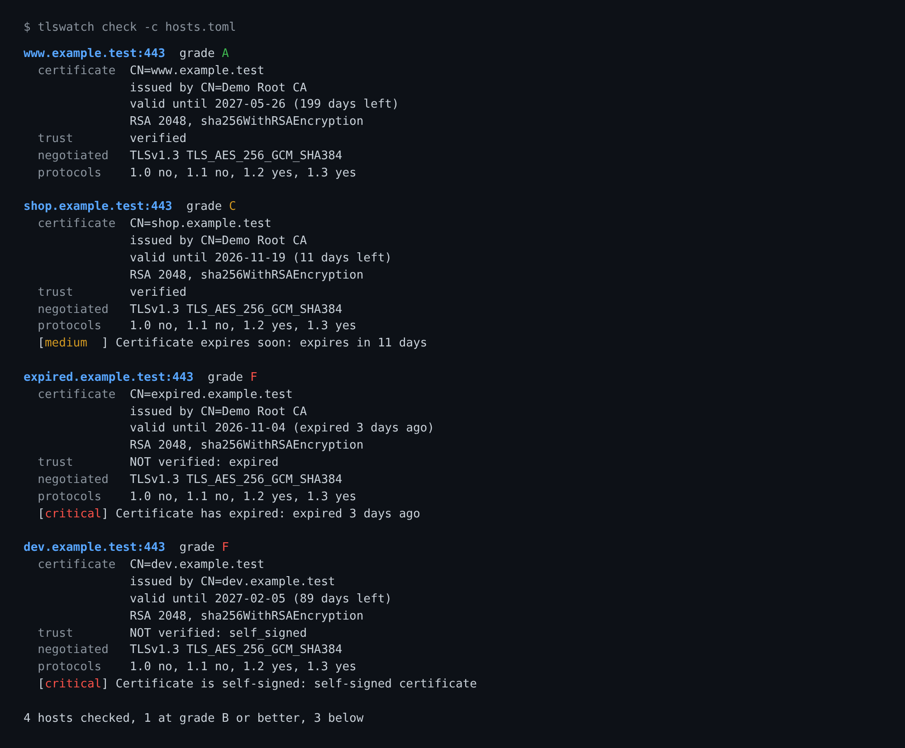

# tlswatch - know about a bad certificate before your users do

[](https://github.com/TexAlphaWolf/sec-tls-cert-monitor/actions/workflows/ci.yml)
[](https://github.com/TexAlphaWolf/sec-tls-cert-monitor/actions/workflows/codeql.yml)
[](https://github.com/TexAlphaWolf/sec-tls-cert-monitor/actions/workflows/live.yml)


Most TLS outages are not attacks: a certificate expired, an intermediate was left out of the chain, a name changed. `tlswatch` connects to a list of hosts, checks what a real client would check, probes the protocol versions and weak cipher suites each server accepts, and gives every host a grade from **A to F with the reasons**. It can run once (exit code for CI and cron) or as a **Prometheus exporter**.

Standard library only at run time: the `ssl` module plus a small X.509 reader written for this project.



*Local demo servers with generated certificates (`tools/demo_server.py`); the output is real.*

## Quick start

```bash
pip install git+https://github.com/TexAlphaWolf/sec-tls-cert-monitor

tlswatch check example.org                       # one host
tlswatch check example.org mail.example.org:993 smtp://mx.example.org:587
tlswatch check -c examples/tlswatch.toml --format json
tlswatch serve -c examples/tlswatch.toml         # metrics on http://127.0.0.1:9117/metrics
```

`check` exits `0` when every host is at the minimum grade (default **B**) or better, `1` otherwise, `2` for a usage error. A host that cannot be reached counts as a failure: silence is not a pass.

**Docker** (non-root, read-only filesystem, no capabilities):

```bash
docker build -t tlswatch .
docker run --rm --read-only --cap-drop ALL tlswatch check example.org
docker run -d --read-only --cap-drop ALL -p 9117:9117 -v "$PWD/examples:/config:ro" tlswatch \
    serve -c /config/tlswatch.toml --listen 0.0.0.0:9117
```

## What it checks

| Area | Checks |
|---|---|
| Certificate | expired, not valid yet, expires in 30 / 7 days (configurable), SHA-1 / MD5 signature, RSA below 2048 bits, short EC keys, DSA |
| Trust | what OpenSSL says a normal client would do: self-signed, unknown CA, missing intermediate, wrong host name, expired intermediate (with `--ca-file` for a private CA) |
| Protocols | TLS 1.0, 1.1, 1.2, 1.3 offered one at a time; 1.0 and 1.1 are findings (RFC 8996); a server stuck on them is graded F, not "unreachable" |
| Weak ciphers | NULL encryption, anonymous, RC4, 3DES, RSA key exchange (no forward secrecy), each offered on its own |
| Mail servers | `smtp://`, `imap://`, `pop3://` targets are upgraded with STARTTLS first |

The grade is the worst grade any finding allows; the rubric is a table in [docs/grading.md](docs/grading.md). It is not the SSL Labs algorithm.

**Be aware of one limit before relying on a clean report:** the cipher probes can only offer what the OpenSSL running `tlswatch` contains. Debian's OpenSSL, which most Python builds and the Docker image use, has no RC4 and no 3DES, so those two are reported as **"not tested from this machine"**, never as "not accepted". `tlswatch capabilities` shows what your machine can test. See [docs/limitations.md](docs/limitations.md).

## Measured

All of it is reproduced by [`tools/evaluate.py`](tools/evaluate.py) and CI fails if the first three rows regress ([method and caveats](docs/evaluation.md)).

| Measurement | Result |
|---|---|
| Parser against the `cryptography` package, 300 random certificates (6 key types, unicode names, IP and wildcard names, dates from 1990 to 2080, serials up to 158 bits) | **0 of 2,700 fields differ** |
| 20,000 corrupt certificates (flipped, truncated, inserted, deleted bytes) | **0 unexpected exceptions**; 17,646 refused cleanly, 2,354 still parsed; slowest parse under 2 ms |
| 22 local servers with one known fault each (expired, wrong name, self-signed, unknown CA, missing / expired intermediate, TLS 1.0, anonymous suites, weak key, refused connection, silent server, plain text, ...) | **22 of 22 diagnosed as expected**, grade and finding |
| Time per host, loopback, all probes (9 connections) | about 20-40 ms; 24 hosts, 8 at a time, 0.4-0.8 s. On the internet each connection costs round trips, so expect seconds per host |

The scenarios were written by the author from the same rubric, so they show that the code follows the rubric, not that the rubric is right. Behaviour against real servers is checked by the [Live workflow](.github/workflows/live.yml) against badssl.com (not part of the numbers above).

## Prometheus

`tlswatch serve` scans in the background and serves the last result on `/metrics` (plus `/healthz`). Metrics include `tlswatch_cert_days_remaining`, `tlswatch_cert_verified`, `tlswatch_grade_score` (A=4 ... F=0), `tlswatch_protocol_supported` and `tlswatch_findings`. Ready-made alert rules are in [examples/prometheus-alerts.yml](examples/prometheus-alerts.yml); every metric is described in [docs/prometheus.md](docs/prometheus.md).

## Commands

```
tlswatch check [TARGET...] [-c|--config FILE] [--format text|json|prometheus] [-o|--output FILE]
               [--starttls smtp|imap|pop3] [--server-name NAME] [--ca-file PEM]
               [--timeout S] [--warn-days D] [--critical-days D] [--min-grade A-F]
               [--workers N] [--no-protocols] [--no-ciphers]
tlswatch serve [same options] [--listen ADDR:PORT] [--interval SECONDS]
tlswatch capabilities
```

Targets are `host`, `host:port`, `[v6]:port` or `smtp://host[:port]`. The configuration file is TOML ([example](examples/tlswatch.toml)); command-line options win over the file.

## Use it on your own hosts

The probes open about 11 connections per host, some with deliberately old protocol versions. That is visible in server logs and can trip an intrusion detection system. Point it at systems you are responsible for.

## Development

```bash
python -m venv .venv && . .venv/bin/activate      # Windows: .venv\Scripts\python.exe -m ...
pip install -e ".[dev]"
ruff check . && ruff format --check . && mypy && pytest --cov
python tools/evaluate.py
python tools/demo_server.py --dir /tmp/demo       # then: tlswatch check -c /tmp/demo/hosts.toml
```

`cryptography` is a development dependency only: tests use it to build certificates and to check the parser. The tests contain no stored certificates or keys.

## License

MIT
